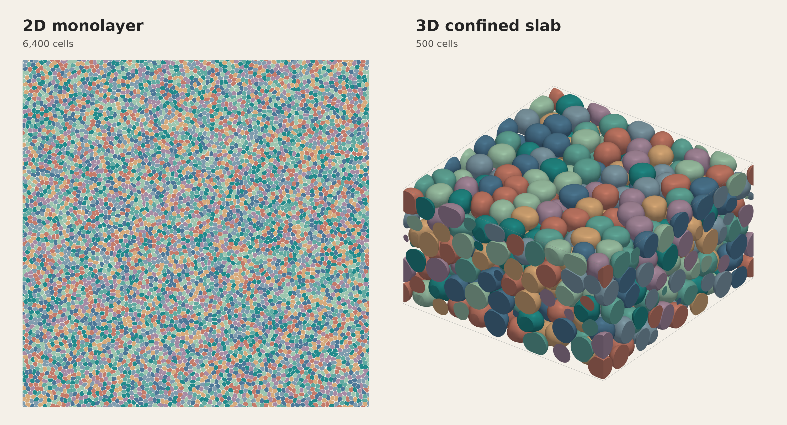
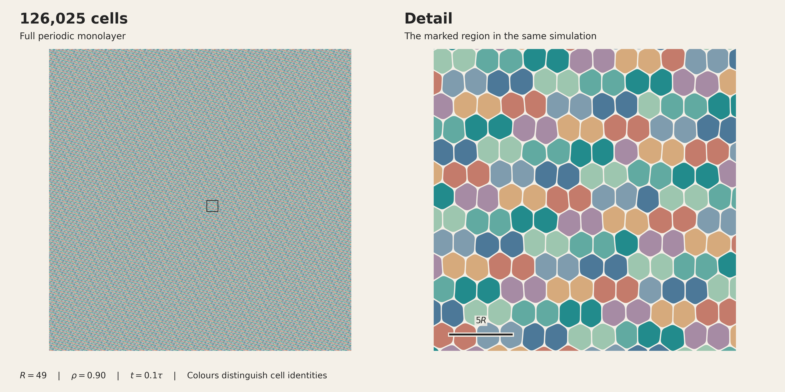
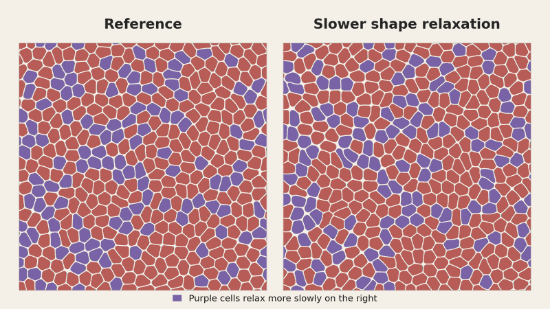

# Cellular MPF

Cellular MPF simulates the motion and deformation of interacting cells on
NVIDIA GPUs. Each cell has its own phase field, so cell shapes and contacts
evolve along with cell motion. The two-dimensional solver implements the
active multiphase-field model of [Palmieri et al. (2015)](https://doi.org/10.1038/srep11745),
with separate controls for interfacial energy, passive relaxation and propulsion.

Simulations can use a periodic monolayer, a three-dimensional periodic domain,
a substrate, or confinement between two walls.



Saved simulation states: a 6,400-cell monolayer (left) and a 500-cell slab
confined between two walls (right). Colours distinguish individual cells.
[Image and movie details](docs/media/README.md).

| Executable | Geometry | Devices |
| --- | --- | --- |
| `cell_gh200` | Periodic 2D monolayer | One GPU |
| `cell_gh200_3d` | Periodic 3D, substrate, or confinement between two walls | One GPU |
| `cell_gh200_3d_two_gpu` | Substrate or confinement between two walls | Two matching GPUs with CUDA peer access |

The [3D guide](docs/three-dimensional-solver.md) describes these
geometries and their assumptions. The substrate has no adhesion, and the
confining walls are purely steric.

## Build

You need an NVIDIA GPU, CUDA 12+, CMake 3.24+, and a C++17 compiler. Python
3.10+ runs the examples and file readers. The commands below build the 2D
solver for H100 or GH200 GPUs (`sm_90`):

```sh
git clone https://github.com/SoftSimu/cellular-mpf.git
cd cellular-mpf
cmake -S . -B build -DCMAKE_BUILD_TYPE=Release \
  -DCMAKE_CUDA_ARCHITECTURES=90 -DPF_BUILD_3D=OFF
cmake --build build --config Release --parallel 8
```

Set `-DPF_BUILD_3D=ON` to include the single-GPU 3D solver. Add
`-DPF_BUILD_TWO_GPU_SUBSTRATE=ON` to build the two-GPU executable.
The 3D solver requires CUDA 12.5+ (`nvcc`) and Hopper-class instructions
(`sm_90` or newer); the current optimized path is tested on GH200. See the
[build notes](docs/solver-reference.md#requirements) for tested configurations,
Windows builds, diagnostic options and installation.

## Run the example

```sh
python3 examples/run_example.py \
  --executable ./build/cell_gh200 --output-dir ./example-output
```

This runs four cells for two timesteps and checks that a trajectory and a
checkpoint were written. Each invocation creates a new directory under
`example-output`. Parameters are in [examples/smoke.args](examples/smoke.args).

Use `./build/cell_gh200 --help` to list all options. A
[longer example](docs/solver-reference.md#minimal-run) shows how to generate
initial cell positions and pass them to the simulator. After building 3D,
run its small example with:

```sh
python3 examples/3d/run_example.py --executable ./build/cell_gh200_3d
```

## Model parameters

The main 2D options are:

| Quantity | Command-line option |
| --- | --- |
| Interfacial coefficient | `--gamma` for normal cells; `--gamma-cancer` for soft cells |
| Soft-cell fraction | `--cancer-fraction` |
| Passive relaxation mobility | `--phase-field-mobility`; individual values through `--phase-field-mobility-map` |
| Propulsion speed | `--v-A` |
| Polarity-persistence time | `--tau` |
| Friction coefficient in interaction advection | `--xi` |

The `cancer` options name the soft-cell population. A
[mobility map](docs/cell-specific-mobility.md) assigns values to individual
cells, allowing passive relaxation to vary at fixed interfacial coefficients.
Propulsion speed and interaction advection have separate coefficients.
The [solver reference](docs/solver-reference.md#model-and-numerical-scheme)
describes the discretization and coefficient definitions. Lengths are in unit
lattice spacings and time is in model units.

## Outputs and restart

| Output | Option | Contents |
| --- | --- | --- |
| Trajectory | `--out` | Positions, velocities and shape measurements; the header defines the columns |
| Checkpoint | `--checkpoint-dir` | Full cell fields and state for restarting |
| 2D velocity contributions | `--velocity-moments` | Propulsion, interaction-advection and passive-relaxation contributions |
| 2D cell boundaries | `--boundary-out` | Field samples for reconstructing contours |
| Projected 3D boundaries | `--boundary-out` | Per-cell silhouettes or substrate footprints |
| 3D cell surfaces | `--surface-out` | Field samples for reconstructing each cell's `phi=0.5` surface |

Recorders are optional. See the [2D velocity](docs/velocity-output.md),
[2D boundary](docs/boundary-output.md), [projected 3D boundary](docs/boundary-output-3d.md)
and [3D surface](docs/surface_output_3d.md) guides for formats and sampling
options. Use a new surface-output filename for each restart segment.

To continue a 2D simulation, pass `-c path/to/checkpoint.bin` and a later
`--t-end`. The 3D checkpoint is named `checkpoint.pf3d`. Checkpoints retain
the fields, cell identities and propulsion state needed for continuation. See
[restart settings](docs/solver-reference.md#outputs-and-restart-behavior).

## Large monolayer

**126,025 cells on one GH200 GPU**, starting from random positions and
relaxed before active motion.



[Full-resolution image](docs/media/monolayer-large-full.png) ·
[Run parameters and checks](docs/media/provenance.json).

## Simulation movies



[Watch in HD](docs/media/kinetic-control.mp4) ·
[Movie details](docs/media/README.md#kinetic-comparison).

The [single-cell movie](docs/media/single-soft-cell.mp4) follows one soft cell
alongside its all-normal reference.

## Tests and documentation

Enable the small CPU references and GPU smoke tests explicitly:

```sh
cmake -S . -B build -DBUILD_TESTING=ON -DPF_ENABLE_GPU_TESTS=ON
cmake --build build --config Release --parallel 8
ctest --test-dir build -C Release --output-on-failure
```

Set `-DPF_ENABLE_GPU_TESTS=OFF` for tests that run on the CPU. The optional two-GPU smoke
compares channel outputs and split restarts against the single-GPU solver.
[Test details](docs/solver-reference.md#tests) also cover the optional
contour/contact tests and their Python dependencies.

Further documentation covers:

- [Model, build variants, initialization and restart](docs/solver-reference.md).
- [3D geometries and examples](docs/three-dimensional-solver.md).
- [Starting 3D simulations from relaxed 2D positions](docs/relaxed-2d-slab-initialization.md).
- [Reconstructing 3D contours and analyzing contact exchanges](docs/contact_exchange_3d.md).

## Citation and license

Software citation details are in [CITATION.cff](CITATION.cff). The underlying
2D model is described by Palmieri et al., *Scientific Reports* **5**, 11745
(2015), [doi:10.1038/srep11745](https://doi.org/10.1038/srep11745).

The SymPhas framework is described in:

- S. A. Silber and M. Karttunen, [SymPhas—General Purpose Software for Phase-Field, Phase-Field Crystal, and Reaction-Diffusion Simulations](https://doi.org/10.1002/adts.202100351), *Advanced Theory and Simulations* **5**, 2100351 (2022).
- S. A. Silber and M. Karttunen, [SymPhas 2.0: Parallel and GPU-accelerated code for phase-field and reaction-diffusion simulations](https://doi.org/10.1016/j.jcp.2026.115363), *Journal of Computational Physics* **568**, 115363 (2027).

The code is distributed under the GNU Lesser General Public License, version 3
or later. See [LICENSE.txt](LICENSE.txt) and [COPYING](COPYING).
