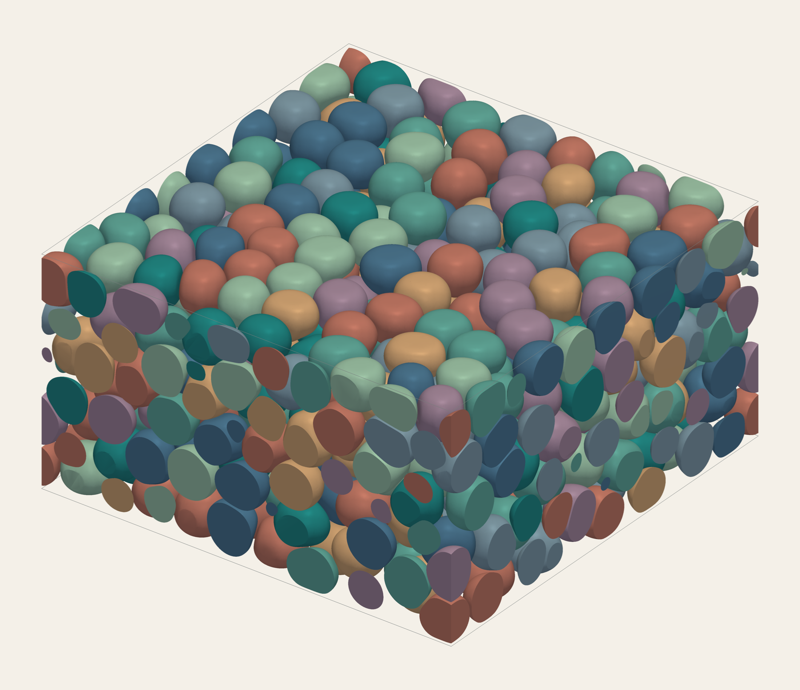

# 3D simulations

Simulate cells in a periodic volume, on a substrate, or between two walls.



A saved 500-cell channel simulation. Colours distinguish individual cells.
[Image details](media/provenance.json).

| `--geometry` | Setup |
| --- | --- |
| `periodic` | Periodic cube with motion in all three directions |
| `slab` | Substrate with no adhesion; propulsion parallel to the surface |
| `channel` | Two steric walls, periodic sides; motion in all three directions |

## Build

From the repository root, with the [build requirements](../README.md#build) installed:

```sh
cmake -S . -B build -DCMAKE_BUILD_TYPE=Release \
  -DCMAKE_CUDA_ARCHITECTURES=90 -DPF_BUILD_3D=ON
cmake --build build --config Release --parallel 8 --target cell_gh200_3d
```

Architecture `90` targets H100 and GH200 GPUs.

## Run

Start a 32-cell channel simulation:

```sh
./build/cell_gh200_3d \
  --geometry channel --channel-height 196 \
  --N 32 --radius 49 --rho 0.60 --brick-edge 224 \
  --dt 0.01 --t-end 100 \
  --out trajectory.txt --checkpoint-dir checkpoints
```

`--rho` sets the volume fraction for channels and periodic cubes, or the
footprint area fraction for substrate slabs. For a slab, use `--geometry slab`
and set its height with `--slab-height`. All lengths and times are in model units.
Use `--help` for the full option list.

## Save and continue

The trajectory records positions, velocities and shape measurements.
Checkpoints save the full state. Continue to a later time with:

```sh
./build/cell_gh200_3d -c checkpoints/checkpoint.pf3d --t-end 200 \
  --out trajectory.txt --checkpoint-dir checkpoints
```

To save cell surfaces as well, add these flags to the original run:

```sh
--trajectory-interval 10000 \
--surface-out interfaces.pfs3d --surface-interval 10000 \
--surface-compression none
```

Intervals count integration steps. Use a new surface filename after each
restart. The [surface guide](surface_output_3d.md) explains compression and
file contents; the [mesh and contact tools](contact_exchange_3d.md) turn
recordings into meshes and contact measurements.

## Two GPUs

For a slab or channel, enable the optional two-GPU executable:

```sh
cmake -S . -B build -DPF_BUILD_3D=ON -DPF_BUILD_TWO_GPU_SUBSTRATE=ON
cmake --build build --config Release --parallel 8 --target cell_gh200_3d_two_gpu
```

Use `cell_gh200_3d_two_gpu` with the same run arguments plus
`--device 0 --peer-device 1 --memory-mode throughput`.
It requires two matching GPUs with CUDA peer access. Each GPU must fit the
full simulation in memory.

See the [solver reference](solver-reference.md) for numerical details and
[initialization from relaxed 2D positions](relaxed-2d-slab-initialization.md)
for preparing a substrate or single-layer channel.
