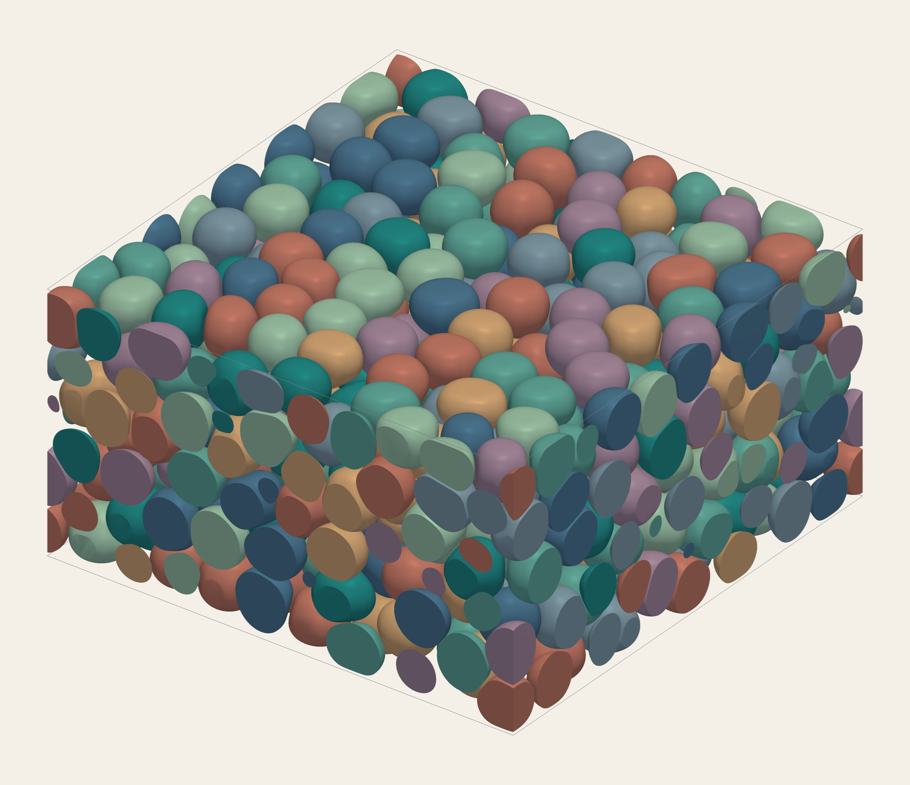

# 3D simulations

Simulate cells in a periodic volume, on a substrate, or between two walls.



A saved 500-cell channel simulation. Colours distinguish individual cells.
[Image details](media/provenance.json).

| `--geometry` | Setup |
| --- | --- |
| `periodic` | Periodic cube with motion in all three directions |
| `slab` | Substrate with no adhesion; propulsion parallel to the surface |
| `channel` | Two steric walls, periodic sides; motion in all three directions |

## Build

From the repository root, with the [build requirements](../README.md#build) installed:

```sh
cmake -S . -B build -DCMAKE_BUILD_TYPE=Release \
  -DCMAKE_CUDA_ARCHITECTURES=90 -DPF_BUILD_3D=ON
cmake --build build --config Release --parallel 8 --target cell_gh200_3d
```

Architecture `90` targets H100 and GH200 GPUs.

## Run

Start a 32-cell channel simulation:

```sh
./build/cell_gh200_3d \
  --geometry channel --channel-height 196 \
  --N 32 --radius 49 --rho 0.60 --brick-edge 224 \
  --dt 0.01 --t-end 100 \
  --out trajectory.txt --checkpoint-dir checkpoints
```

`--rho` sets the volume fraction for channels and periodic cubes, or the
footprint area fraction for substrate slabs. For a slab, use `--geometry slab`
and set its height with `--slab-height`. All lengths and times are in model units.
Use `--help` for the full option list.

### Neutral substrate with a lid or free surface

Slab motion is horizontal: both propulsion and interaction-induced velocity have zero z component. The phase field can still change height through relaxation. The bottom face has a zero normal derivative, with no adhesion or wall energy.

`--slab-top free` retains a distant zero-field boundary and stops if a cell reaches it. `--slab-top lid` places a zero-field boundary at the upper face, using an odd-reflected ghost. `--slab-top neutral` instead reflects the upper ghost evenly and initializes uniform columns for a planar-reduction check. The physical face separation is `--slab-height`; the cell-centred lattice runs from half a voxel above the substrate to half a voxel below the upper face.

`--reference-height h` sets the target volume to `h*pi*R^2`, independently of the box height. Without this option the target is the hemispherical volume. The footprint fraction remains `N*pi*R^2/(Nx*Ny)`; it is a target area convention, not a measurement of the occupied basal area.

`--phase-field-mobility M` multiplies the complete passive field equation by `M/0.5`, leaving advection and the velocity law unchanged. To reproduce a planar model in a uniform column of height h, divide its gamma, kappa and mu by h, multiply M by h, keep xi and the active parameters unchanged, and use `--reference-height h --slab-height h --slab-top neutral`. Integrating over z then recovers the planar forces, area constraint and field update. A free surface or non-wetting lid permits height-dependent shapes, so this reduction is a verification problem rather than a prediction of identical cell-layer dynamics.

These settings are stored in checkpoints and trajectory metadata. Parameter records use an optional 16-byte extension for mobility and reference height; checkpoints without it retain M=0.5 and the original target volume. Older executables reject the extended record rather than silently dropping its parameters.

For cell-specific relaxation, `--phase-field-mobility-map path` reads rows of `global_id M` with optional `#` comments. Values are absolute positive mobilities. The override multiplies every passive term, including wall repulsion, but not advection, polarity, or the interaction velocity. On restart, listed cells are replaced and unlisted cells retain their stored values. Omitting the map preserves all overrides. Checkpoints store each override; zero in that record means inherit the uniform mobility. A trajectory header identifies the assignment by a hash, preventing an altered assignment from being appended to an existing trajectory. Use a new output path when branching a checkpoint into a different mobility condition.

## Save and continue

The trajectory records positions, velocities and shape measurements.
Checkpoints save the full state. Continue to a later time with:

```sh
./build/cell_gh200_3d -c checkpoints/checkpoint.pf3d --t-end 200 \
  --out trajectory.txt --checkpoint-dir checkpoints
```

To save cell surfaces as well, add these flags to the original run:

```sh
--trajectory-interval 10000 \
--surface-out interfaces.pfs3d --surface-interval 10000 \
--surface-compression none
```

Intervals count integration steps. Use a new surface filename after each
restart. The [surface guide](surface_output_3d.md) explains compression and
file contents; the [mesh and contact tools](contact_exchange_3d.md) turn
recordings into meshes and contact measurements.

## Two GPUs

For a slab or channel, enable the optional two-GPU executable:

```sh
cmake -S . -B build -DPF_BUILD_3D=ON -DPF_BUILD_TWO_GPU_SUBSTRATE=ON
cmake --build build --config Release --parallel 8 --target cell_gh200_3d_two_gpu
```

Use `cell_gh200_3d_two_gpu` with the same run arguments plus
`--device 0 --peer-device 1 --memory-mode throughput`.
It requires two matching GPUs with CUDA peer access. Each GPU must fit the
full simulation in memory.

Whole cells are assigned by their position along `y`. The partition is chosen
at initialization or restart to balance the allocated update tiles, then held
fixed for that segment. As cells move, ownership follows this partition; the
fields themselves are never split between GPUs. Checkpoints retain cell
identities and random-number state independently of device ownership.

Cells contributing to exchanged rows are measured and updated first. Their
transfers overlap the remaining cells' measurements and interior updates;
received sums are merged before the step is accepted. Each cell keeps its
existing reduction order and random-number sequence.

See the [solver reference](solver-reference.md) for numerical details and
[initialization from relaxed 2D positions](relaxed-2d-slab-initialization.md)
for preparing a substrate or single-layer channel.
